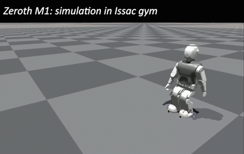
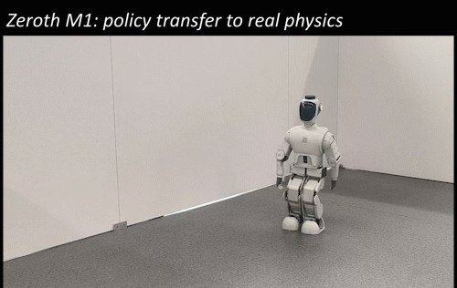

# Zeroth M1 Humanoid Robot - RL Deployment

🌎 English | [🇨🇳 中文](README_zh.md)

---

## Overview

This repository contains the **reinforcement learning policy deployment framework** for the **Zeroth M1 humanoid robot**. It provides a complete pipeline for deploying trained RL policies (ONNX format) from simulation to the real robot hardware.

<div align="center">

| Isaac Gym Simulation | Real Robot Deployment |
|:---:|:---:|
|  |  |
| *Policy training in Isaac Gym* | *Deployed on Zeroth M1 hardware* |

</div>

---

## 📁 File Structure

| File/Directory | Description |
|---|---|
| **demo_walk.py** | Main walking demo - deploys RL policy for locomotion control |
| **demo_walk_estimator.py** | Walking demo for deployment of the estimator model |
| **control_system.py** | ROS2 control system class for subscribing to robot sensor data (IMU, joint states) and publishing joint commands |
| **spin_control_system.py** | Observation data readback example program |
| **config_mini.yaml** | Robot configuration file containing default joint angles, zero-position offsets, observation dimensions, and scaling factors |
| **udp_sender.py** | Real-time data streaming class for sending telemetry to PlotJuggler via UDP |
| **model/** | Directory for storing trained RL policies in ONNX format |
| **pylibs/** | Python dependencies and libraries required for deployment |


---

## 🚀 Deployment Guide

### 1. Clone Repository

```bash
git clone <repository-url>
cd JOYIN_MINI_DEPLOY
```

### 2. Connect to Robot

Connect your development machine to the **same local network** as the robot's WiFi, then SSH into the robot:

```bash
ssh <robot-username>@<robot-ip>
```

### 3. Run Deployment

Place your trained ONNX model in the `model/` directory, then run:

```bash
python demo_walk.py --model=model/your_model_name.onnx
```

---

### Custom Policy Deployment

**Single-frame observation composition:**
The current policy input is a concatenation of the following:

- Command velocities (vx, vy, yaw_rate) × `cmd_scale`
- IMU angular velocity (3 axes) × `ang_vel_scale`
- Gravity vector in body frame × `gravity_scale`
- Joint position offsets × `dof_pos_scale`
- Previous actions
- Phase encoding (sin, cos)

---

### Observation Stacking

The M1 robot uses **observation history stacking** (default: 5 frames) as input to the policy network. The stacked observations are concatenated and fed into the ONNX model for action inference.

**Write the same configuration as training in `config_mini.yaml`:**

```yaml
num_obs: <single-frame observation dim>
num_stack: 5  # number of frames to stack
stepping_period: <swing phase + stance phase for each leg>
default_angles: <default angles for leg joints>
default_angles_arm: <default angles for arm joints>
num_actions: <number of joints used by the policy>
```

Note: The `kp` and `kd` values in the config file are inherent robot settings — modifying them will degrade policy deployment performance.

---

### Observation Variable Access

- Velocity commands: set via `cmd.vx`, `cmd.vy`, `cmd.dyaw` in the deployment script (`demo_walk.py`)
- IMU angular velocity: defined as `imu_angular_velocity` in the `state` dict in `control_system.py`; indices 0, 1, 2 correspond to roll, pitch, yaw respectively
- Gravity projection in body frame: provided by `gravity_in_body` in the `state` dict
- Joint positions: leg joints via `joint_position`, arm joints via `joint_position_arm` in the `state` dict
- Joint velocities: leg joints via `joint_velocity`, arm joints via `joint_velocity_arm` in the `state` dict
- Previous actions: `action` in the deployment script (`demo_walk.py`)
- Phase encoding: `sin_phase`, `cos_phase` in the algorithm class in `demo_walk.py`

---

## 📝 Notes

- The robot operates at **50Hz control frequency** by default
- PlotJuggler integration is available for real-time telemetry visualization (see `udp_sender.py`)
- For trajectory replay and sim-vs-real validation, use `trajectory_replay.py`

---

## 🎉 Acknowledgments

This repository builds upon the following open-source projects. We are grateful for their contributions:

- **legged_gym**: Core codebase for training framework and environment setup
- **rsl_rl**: Efficient implementation of PPO and other RL algorithms
- **Isaac Gym**: GPU-accelerated high-performance parallel physics simulation platform

---

## 📧 Support

For technical support or questions, contact **Suzhou JoyIn Technology Co., Ltd**.

---

**License:** GNU General Public License v2.0 (GPL-2.0)

This project is distributed under the GPL-2.0 license. Please refer to the `LICENSE` file in the repository root for the full terms.

Example copyright notice:

> Copyright (C) 2026 Suzhou JoyIn Technology Co., Ltd.
> Copyright (C) 2026 苏州乐享智能科技有限公司
>
> This program is free software; you can redistribute it and/or modify
> it under the terms of the GNU General Public License as published by
> the Free Software Foundation; either version 2 of the License, or
> (at your option) any later version.

Note: If you distribute this project to third parties, GPL-2.0 requires that the source code and the license text be provided together, and that copyright notices remain intact.
